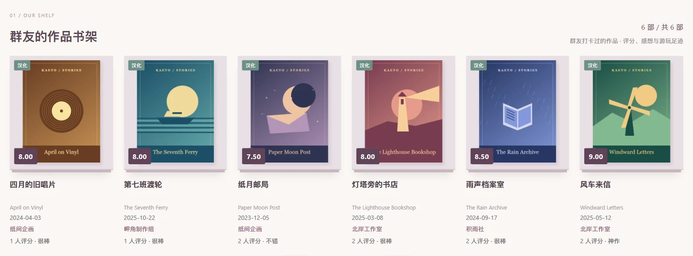
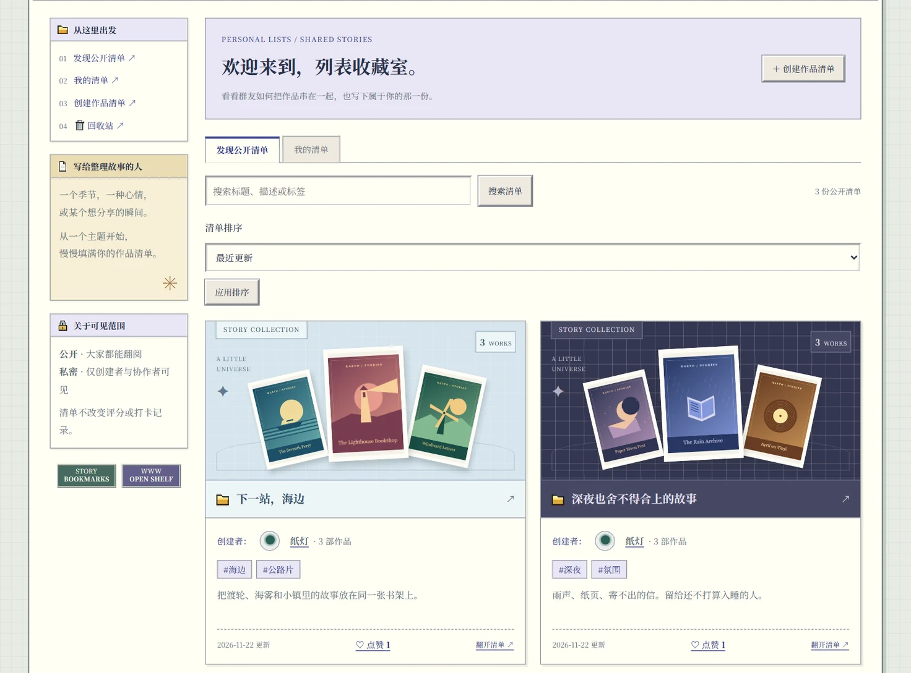
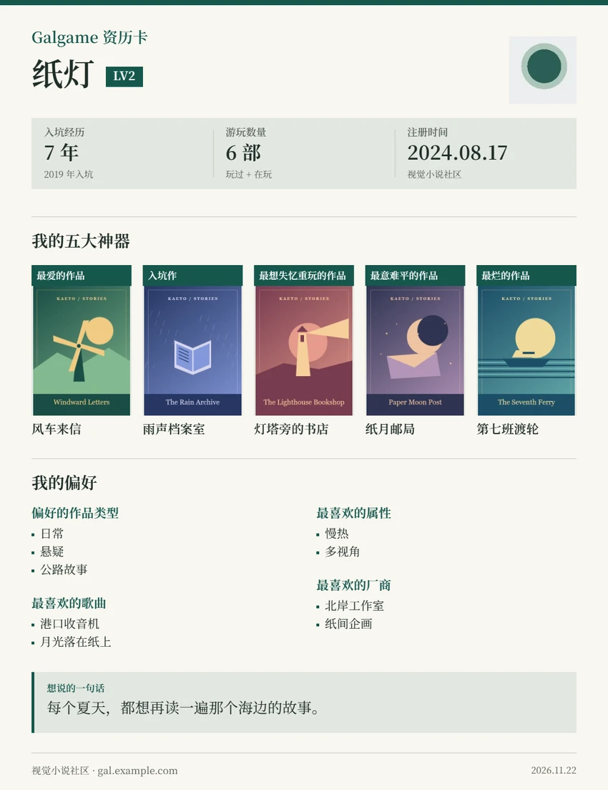

<table>
  <tr>
    <td width="75%" valign="middle">
      
      <h1>Kaeto Community</h1>
      <p><strong>给视觉小说同好自建的社区书架</strong><br>
      A self-hosted visual novel catalog, play journal, and community shelf.</p>
      <p>
        <a href="LICENSE"></a>
        <a href="#快速开始"></a>
      </p>
      <p>
        <a href="#快速开始"><strong>本地试用</strong></a> ·
        <a href="#界面预览">界面预览</a> ·
        <a href="deploy/README.md">自建部署</a> ·
        <a href="https://kaeto.top/">糖糖星 2.0 ↗</a>
      </p>
    </td>
    <td width="25%" align="center" valign="middle">
      <a href="https://kaeto.top/"></a>
    </td>
  </tr>
</table>

## 用 Kaeto 做什么

- **记下玩过的故事**　浏览作品资料，标记想玩、在玩或玩过，留下评分和感想。通过「群友最近在玩」发现大家正在读的作品。
- **和朋友一起整理书架**　按主题创建公开或私密清单，添加标签、推荐语和封面配色。公开清单可以分享、点赞，也可以邀请朋友共同编辑。
- **做一张自己的资历卡**　把入坑年份、代表作品和喜欢的角色排进一张长图。草稿跟随账号，分享用的 PNG 由浏览器生成。

## 界面预览

[](docs/images/catalogue.webp)

<p align="center">
  <a href="docs/images/lists.webp"></a>
  <a href="docs/images/story-card.webp"></a>
</p>

截图来自开源版的本地实例。图中的成员、作品、封面和清单均为演示样本。

## 快速开始

需要 **Node.js 22+** 和 npm。本地演示使用 JSON 存储，安装依赖后即可离线体验。

```sh
git clone https://github.com/meguru296/kaeto-community.git
cd kaeto-community
npm ci
cp config.example.json config.json
npm run admin -- demo-admin
npm run demo
npm start
```

Windows PowerShell 请用 `Copy-Item config.example.json config.json` 复制配置。打开 [本地演示](http://127.0.0.1:8787)，使用 `demo-admin` 和初始化时终端显示的随机密码登录。演示数据只在空白本地书架中初始化一次。

## 自建部署

自建时可选择本地 JSON 或 PostgreSQL，配合 Caddy 或 nginx 对外提供 HTTPS。应用使用单个写入进程。可按需配置作品和角色资料来源、Steam 或邮件，社区页面的内容由实例运营者维护。[部署说明](deploy/README.md)

## 参与项目

本地运行 `npm run check` 可验证主要功能。检查使用独立配置、临时数据和模拟邮件。想提交建议或反馈问题，可带上复现步骤或界面截图。[GitHub Issues](https://github.com/meguru296/kaeto-community/issues)

安全问题请通过 GitHub 私密渠道报告。[安全报告说明](SECURITY.md)

## 许可

项目代码及自制占位素材采用 MIT 许可证。README 展示的糖糖星图标与枫糖插画由糖糖星官网提供，相关权利由权利人保留。[MIT 许可证](LICENSE) · [第三方声明](THIRD_PARTY_NOTICES.md)
